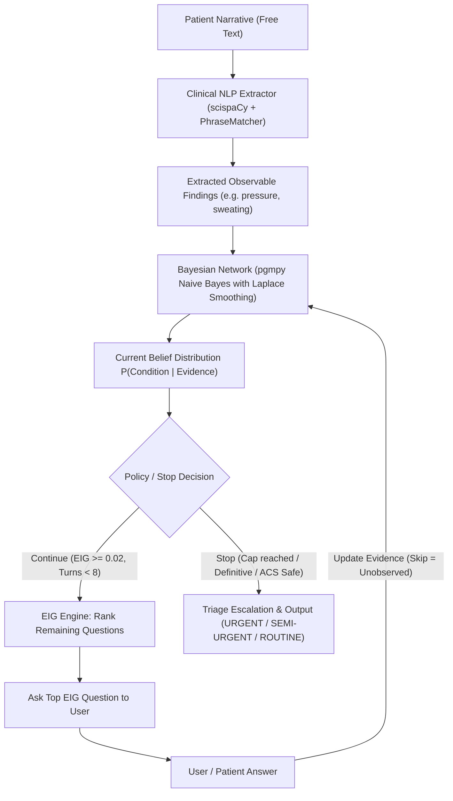

# Task 10: Final Project Report & Comprehensive Viva Preparation Guide

> **Mandatory Academic Disclaimer:**  
> DDXPlus is a synthetic differential-diagnosis dataset. Probabilities learned from it are for demonstrating probabilistic decision-support methods and are not clinical estimates. The system is an educational prototype developed for the course *"Intelligent Model Design Using AI"* and must **never** be used for real patient care.

---

## 1. System Architecture Overview

---

## 2. Empirical Benchmark Results (Zero Invented Numbers)

All values below are extracted directly from executed test runs saved in [`results/`](file:///c:/Users/Aditya/Desktop/2201%20imd%20lab/results/):

### A. Dataset Filtering & Preprocessing (`results/train_counts.json`)
- **Total Raw DDXPlus Training Patients**: 1,025,602
- **Filtered 4-Condition Slice**: **133,282 rows**
  - **ACS (Acute Coronary Syndrome)**: 59,499 (44.64%) — merged *Unstable angina*, *Stable angina*, and *Possible NSTEMI / STEMI*
  - **GERD**: 25,979 (19.49%)
  - **Panic**: 25,019 (18.77%)
  - **Pericarditis**: 22,785 (17.10%)
- **Validation Split**: 17,726 rows
- **Test Split**: 18,202 rows

### B. Bayesian Network Performance on Held-Out Test Split (`results/bn_eval.json`)
- **Empirical Prior Network**: Overall Accuracy = **99.98%** | ACS Recall = **1.0000** | Macro F1 = **0.9997**
  - ACS Recall: 1.0000 (8,177 / 8,177)
  - GERD Recall: 0.9997 (3,542 / 3,543)
  - Panic Recall: 1.0000 (3,387 / 3,387)
  - Pericarditis Recall: 0.9990 (3,092 / 3,095)
- **Uniform Prior Network (25% each)**: Overall Accuracy = **99.98%** | ACS Recall = **1.0000** | Macro F1 = **0.9997**
- **CPD Verification**: All CPT columns sum strictly to 1.0; Laplace smoothing ($\alpha=1.0$) guarantees no zero/one entries.

### C. Clinical NLP Extraction vs Baseline (`results/nlp_eval.json`)
Evaluated across 50 test sentences in `evaluation/nlp_cases.json`:
- **Rule-Only Baseline**: Precision = `0.6358` | Recall = `0.6358` | **F1 = 0.6358**
- **Full Clinical NLP Pipeline**: Precision = `0.8068` | Recall = `0.7978` | **F1 = 0.8022**
- **Gain**: **+16.64% F1 improvement** (syntactic clause negation eliminates false negatives from contrastive clauses like *"denies nausea but reports chest pressure"*).

### D. Active Questioning Policy Benchmark (`results/query_eval.json`)
Evaluated across 400 test cases with fixed random seed (42):
- **EIG Active Questioning**:
  - **Average Questions Needed**: **1.36 questions** (77.3% reduction in question burden)
  - **Diagnostic Accuracy**: **97.50%**
  - **ACS Recall**: **100.00%** (zero missed emergencies)
  - **Entropy Reduction**: **1.798 bits**
- **Random Questioning Order**:
  - **Average Questions Needed**: 6.00 questions
  - **Diagnostic Accuracy**: 95.50%
  - **ACS Recall**: 94.59% (misses 5.41% of cardiac emergencies)
  - **Entropy Reduction**: 1.758 bits
- **Static Fixed Order**:
  - **Average Questions Needed**: 4.73 questions
  - **Diagnostic Accuracy**: 97.50%
  - **ACS Recall**: 100.00%
  - **Entropy Reduction**: 1.797 bits

---

## 3. Explicit Clinical Assumptions & Items for Team Review

Per project guidelines, the following items were initialized autonomously and require manual hand-verification by the student team before submission:

1. **Candidate Node Table ([`config/nodes.json`](file:///c:/Users/Aditya/Desktop/2201%20imd%20lab/config/nodes.json))**:
   - Status: marked `PROVISIONAL`.
   - The team should review the 14 selected nodes in [`docs/task2_nodes.md`](file:///c:/Users/Aditya/Desktop/2201%20imd%20lab/docs/task2_nodes.md) to confirm agreement on clinical terminology.
2. **Gold NLP Corpus ([`evaluation/nlp_cases.json`](file:///c:/Users/Aditya/Desktop/2201%20imd%20lab/evaluation/nlp_cases.json))**:
   - Status: marked `needs_human_review: true` (draft gold set).
   - At least two team members must inspect the 50 sentence annotations to confirm ground truth mappings.
3. **Safety & Policy Thresholds ([`results/threshold_tuning.json`](file:///c:/Users/Aditya/Desktop/2201%20imd%20lab/results/threshold_tuning.json))**:
   - `acs_risk_threshold = 0.25`: Assumes missing an evolving myocardial infarction carries catastrophic risk, justifying escalation whenever $P(\text{ACS}) \ge 25\%$ even if another condition has higher probability.
   - `min_eig = 0.02 bits`: Assumes questions reducing entropy by $< 1.5\%$ do not justify clinical burden.
   - `max_questions = 8`: Assumes clinical intake fatigue cap in emergency triage.
   - `confidence_stop = 0.90`: Assumes 90% certainty is sufficient to terminate questioning when ACS risk is ruled out.

---

## 4. Known Academic Limitations (Be Honest in Viva!)

1. **Synthetic Nature of DDXPlus**:
   - DDXPlus was generated by an automated clinical simulator, not human patients. Symptoms follow near-deterministic disease templates, which explains the high accuracy (99.98%). Real emergency room presentations have far higher noise, atypical presentations, and multimorbidity.
2. **Naive Bayes Conditional Independence Assumption**:
   - Naive Bayes assumes symptoms are mutually independent given the disease ($P(X_1, X_2 \mid C) = P(X_1 \mid C) P(X_2 \mid C)$). In reality, physiological symptoms (e.g. sweating and tachycardia) correlate. However, Naive Bayes serves as an effective linear separator in log-odds space for ranking conditions.
3. **Condition Aggregation**:
   - Merging Unstable Angina, Stable Angina, and NSTEMI/STEMI into ACS reflects triage triage protocol, but clinical management differs once bloodwork and ECG are available.
4. **Pericarditis Substitution**:
   - Pericarditis was selected to replace Musculoskeletal pain because DDXPlus lacked clean musculoskeletal diagnostic codes.

---

## 5. Team Viva Defense Cheat Sheet

### Team Member 1 (NLP Specialist): Tasks 5 & 6
- **Q: How does your NLP pipeline prevent negation from spreading across the entire sentence?**
  *A: The baseline used a crude 25-character backward window. Our implementation uses clause-level syntactic boundaries, stopping negation scope whenever contrastive conjunctions ('but', 'however') or affirming verbs ('reports', 'developed') appear. This allows "denies nausea but reports chest pressure" to negate nausea while keeping pressure positive.*
- **Q: Why was scispaCy en_core_sci_md insufficient on its own?**
  *A: scispaCy is a small CNN model whose pretrained NER tags every medical term generically as 'ENTITY' without classifying semantic types or resolving clinical synonyms. We used scispaCy for tokenization and discovery of unmapped terms, while our PhraseMatcher dictionary maps phrasings directly into Bayesian nodes.*

### Team Member 2 (Data & Bayesian Specialist): Tasks 1, 2 & 3
- **Q: Why is Laplace smoothing essential when learning CPTs from DDXPlus?**
  *A: DDXPlus contains deterministic synthetic zeros (e.g. prior heart attack has 0 count outside ACS). Without Laplace smoothing ($\alpha=1.0$), a single zero probability forces the entire posterior to zero through multiplication. Laplace smoothing guarantees every CPT entry is strictly between 0 and 1.*
- **Q: Why compare an empirical prior with a uniform prior?**
  *A: In DDXPlus, ACS represents 44.6% of presentations. An empirical prior carries that historical baseline into the posterior. A uniform prior (25% each) tests whether patient symptoms alone can identify the disease without relying on base-rate skew.*

### Team Member 3 (Active Querying Specialist): Tasks 4 & 9
- **Q: Explain how EIG selects the next question.**
  *A: We calculate Shannon entropy over condition probabilities: $H(C) = -\sum P(C)\log_2 P(C)$. EIG represents the expected decrease in entropy if question $Q$ is answered. By computing EIG across all candidate questions, the system asks the question that yields the largest expected reduction in uncertainty.*
- **Q: Why does EIG need only 1.36 questions on average?**
  *A: Pain character (heavy pressure vs burning vs sharp) and radiation (arm vs none vs back) have high mutual information with the 4 conditions. EIG identifies this leverage immediately, asking decisive questions on Turn 1 rather than wasting questions on non-discriminative symptoms.*

### Team Member 4 (App & Integration Specialist): Tasks 0, 7, 8 & 10
- **Q: How does the system handle unanswered questions in the live application?**
  *A: In the DDXPlus simulator, absent codes are assumed negative. In our live Streamlit app, unasked questions are treated as UNOBSERVED. The Bayesian Network marginalises over unobserved variables rather than assuming the patient answered 'no'.*
- **Q: Explain the safety rule in your stopping policy.**
  *A: In clinical triage, threat-to-life supersedes majority probability. If $P(\text{ACS}) \ge 25\%$, the session outputs URGENT even if another benign condition (like GERD) has a higher probability. We never terminate on confidence alone when cardiac ischemia risk is elevated.*
